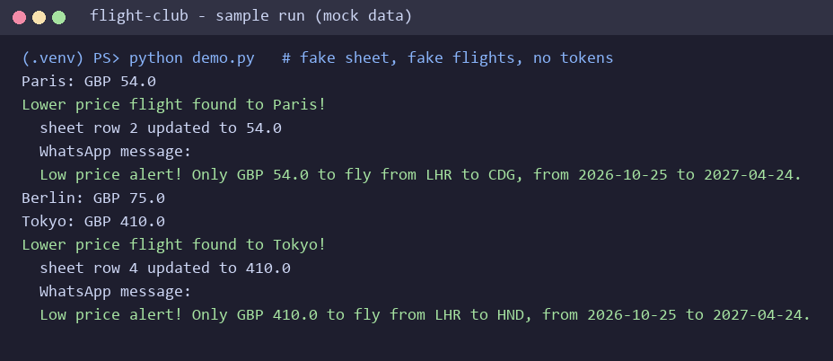
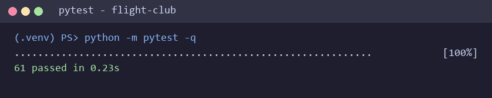

# 🚀 Personal Flight Club

A flight-deal finder (Day 39 capstone of Udemy's "100 Days of Code: The Complete Python Pro Bootcamp"): it reads destinations and price limits from a Google Sheet, finds the cheapest return flight for the next six months and sends a WhatsApp message when a price is below the limit. It is for course participants who want to compare solutions and for anyone who browses the repository for ideas.

## 📚 Table of Contents

- [Overview](#-overview)
- [Requirements](#-requirements)
- [Setup](#-setup)
- [Run](#-run)
- [Tests](#-tests)
- [License](#-license)
- [Links](#-links)
- [Appendix: Project documents](#-appendix-project-documents)

## 🧭 Overview

The program keeps the assignment's class and function names.

| Module (`src/flight_club/`) | What it does |
| --- | --- |
| `data_manager.py` | `DataManager`: reads the sheet rows from Sheety and writes a new lowest price back |
| `flight_search.py` | `FlightSearch.check_flights()`: asks SerpAPI Google Flights, or the course's mock flight service, for flights |
| `flight_data.py` | `FlightData` and `find_cheapest_flight()`: picks the cheapest flight, with `N/A` when there is none |
| `notification_manager.py` | `NotificationManager`: builds the message and sends it through WhatsApp |
| `main.py` | Wires everything together; `python -m flight_club` runs it |
| `constants.py` | All constants (URLs, origin airport, currency, cache settings, variable names) |
| `cache.py` | Local response cache that never stores the Sheety answers |



## 📋 Requirements

- Python 3.13 or newer.
- Runtime packages (installed by pip): `requests`, `requests-cache`, `python-dotenv`.
- Optional, only to send WhatsApp messages: `pywhatkit`, a browser and a logged-in WhatsApp Web session.
- A Sheety project for your copy of the Google Sheet (Bearer authentication and PUT enabled), and either a SerpAPI key or the course's mock flight service credentials.

## 🛠️ Setup

Create and use a local virtual environment, then install the project.

PowerShell (Windows):

```powershell
py -3.13 -m venv .venv
.\.venv\Scripts\Activate.ps1
python -m pip install --upgrade pip
python -m pip install -e ".[dev]"
```

Bash (Linux, macOS):

```bash
python3.13 -m venv .venv
source .venv/bin/activate
python -m pip install --upgrade pip
python -m pip install -e ".[dev]"
```

For WhatsApp delivery add the optional extra: `python -m pip install -e ".[whatsapp]"`.

Create your own `.env` from the template and fill in your values. `.env` is ignored by git; never commit it.

```bash
cp .env.example .env
```

| Variable | Meaning |
| --- | --- |
| `SHEETY_ENDPOINT` | Endpoint of the `prices` sheet in your Sheety project |
| `SHEETY_TOKEN` | Bearer token of the Sheety project |
| `FLIGHT_PROVIDER` | `serpapi` or `mock` |
| `SERPAPI_API_KEY` | Your SerpAPI key (provider `serpapi`) |
| `MOCK_FLIGHTS_APP_ID`, `MOCK_FLIGHTS_APP_KEY` | Credentials of the mock flight service (provider `mock`) |
| `MOCK_FLIGHTS_URL` | Optional: override the mock service URL |
| `WHATSAPP_NUMBER` | Your own number with country code, for example `+441234567890` |

Keep 3 to 5 destinations in the sheet to stay inside the free tiers (SerpAPI 100 searches a month, Sheety 200 requests a month). Flight answers are cached for one hour in `flight_cache.sqlite`; delete the file to force fresh searches.

## ▶️ Run

```bash
python -m flight_club
```

or, after the editable install, `flight-club`. For every sheet row the program prints the cheapest price. When it is lower than the sheet's lowest price, it updates the sheet and sends a WhatsApp message with the price, both airport codes and both dates. Without `WHATSAPP_NUMBER` or `pywhatkit` it prints the message instead.

## 🧪 Tests

The tests use no network, no WhatsApp and never read your `.env`.

```bash
python -m pytest
```



Optional checks used by the CI: `python -m ruff check .`, `python -m ruff format --check .` and `python -m mypy --strict src tests`. Build the API documentation with `doxygen Doxyfile` (output in `docs/doxygen/`).

## 📄 License

See [LICENSE][license].

## 🔗 Links

- [Repository][repository]
- [Documentation][documentation]
- [Issue tracker][issues]

## 📎 Appendix: Project documents

The documents a newcomer needs, in reading order.

| Document | What it tells you |
| --- | --- |
| [AGENTS.md][agents] | The rules AI agents follow in this repository |
| [Business Case][BC-001] | Why the project exists, its scope and success criteria |
| [Stakeholder Analysis][SA-001] | Who is involved; the stakeholder IDs used for owners and reviewers |
| [Project Plan][PP-001] | The gateways and their schedule |
| [Milestones][milestones] | One document per gateway: Go/No-Go criteria and tasks |
| [Artifact registry][registry] | Where each artifact type lives, the next version, the PO language and domain |
| [Framework README][framework-readme] | The framework this project uses |
| [Framework changelog][framework-changelog] | What changed in each framework release |

---

[license]: ./LICENSE
[repository]: https://git.tirsystem.com/Tirsvad-Udemy-100-days-of-code/039-personal-flight-club
[documentation]: https://git.tirsystem.com/Tirsvad-Udemy-100-days-of-code/039-personal-flight-club/wiki
[issues]: https://git.tirsystem.com/Tirsvad-Udemy-100-days-of-code/039-personal-flight-club/issues
[agents]: ./AGENTS.md
[BC-001]: ./docs/business-case.md
[SA-001]: ./docs/stakeholder-analysis.md
[PP-001]: ./docs/project-plan.md
[milestones]: ./docs/milestones/
[registry]: ./docs/artifact-registry.md
[framework-readme]: ./framework/README.md
[framework-changelog]: ./framework/CHANGELOG.md
