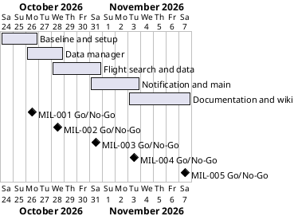

# Project Plan

## Metadata
| Key | Value |
| --- | --- |
| ID | PP-001 |
| CrossReference | [BC-001], [SA-001], [MIL-001], [MIL-002], [MIL-003], [MIL-004], [MIL-005] |
| Language | en |
| Domain | it |

## Version History
| Date | Status | Author | Reviewer | Change | Commit |
| --- | --- | --- | --- | --- | --- |
| 2026-10-24 | Accepted | Jens Tirsvad Nielsen | S01 | Initial version | [1c49ffe] |

---

## Purpose

This plan schedules the five phases that deliver the Day 39 flight-deal finder (see [BC-001]) in a two-week window. One branch and one pull request per milestone keep track of the steps.

## Planning Assumptions

- Week 1 starts 2026-10-24; the plan ends by 2026-11-07.
- Each phase ends in a pull request that closes its issues; the Product Owner is S01 ([SA-001]).
- Autonomous mode: the AI creates, reviews as stand-in for S01, commits and merges after the user accepts this plan.
- Tests never use the real `.env`, the network or the WhatsApp session.

## Gateway Schedule

| Gateway | Document | Window | Decision date | Owner | Stories | Main deliverable | Milestone |
| --- | --- | --- | --- | --- | --- | --- | --- |
| Baseline and setup | [MIL-001] | 2026-10-24 to 2026-10-26 | 2026-10-26 | S01 | none | Project skeleton, CI, repository metadata | |
| Data manager | [MIL-002] | 2026-10-26 to 2026-10-28 | 2026-10-28 | S01 | none | Sheety read and update | |
| Flight search and data | [MIL-003] | 2026-10-28 to 2026-10-31 | 2026-10-31 | S01 | none | Search, parsing, cheapest flight | |
| Notification and main | [MIL-004] | 2026-10-31 to 2026-11-03 | 2026-11-03 | S01 | none | WhatsApp message and main program | |
| Documentation and wiki | [MIL-005] | 2026-11-03 to 2026-11-07 | 2026-11-07 | S01 | none | README, wiki en/da/ms, screenshots | |



## Scope Coverage

| Business Case scope item | Gateway |
| --- | --- |
| Project setup, pyproject, constants, .gitignore, Doxyfile, venv | [MIL-001] |
| CI workflows, repository description and topics | [MIL-001] |
| DataManager and request caching | [MIL-002] |
| FlightSearch, FlightData, find_cheapest_flight | [MIL-003] |
| NotificationManager (WhatsApp) and main.py | [MIL-004] |
| README, wiki in en/da/ms, screenshots | [MIL-005] |

## Dependencies

```
MIL-001 → MIL-002 → MIL-003 → MIL-004 → MIL-005
```

A No-Go on a phase moves every later date by the rework time.

## Plan Risks

| Risk | Impact | Mitigation |
| --- | --- | --- |
| CI workflows need changes or a runner the host lacks | MIL-001 slips | Install only fitting workflows; stop and report after three failed fixes |
| Screenshots cannot be captured without real data | MIL-005 slips | Use mock data and a test run only |
| The SerpAPI key is missing from the local `.env` | MIL-003 uses only the mock provider | Provider is a setting; mock keys exist locally |

## Open Issues

- The WhatsApp module is assumed to be `pywhatkit` ([BC-001] Assumptions); the user can correct it before acceptance.
- No SerpAPI key is in the local `.env` yet; the mock flight service is the default until it is added.

---

[BC-001]: ./business-case.md
[SA-001]: ./stakeholder-analysis.md
[MIL-001]: ./milestones/mil-001-baseline-and-setup.md
[MIL-002]: ./milestones/mil-002-data-manager.md
[MIL-003]: ./milestones/mil-003-flight-search-and-data.md
[MIL-004]: ./milestones/mil-004-notification-and-main.md
[MIL-005]: ./milestones/mil-005-documentation-and-wiki.md
[1c49ffe]: https://git.tirsystem.com/Tirsvad-Udemy-100-days-of-code/039-personal-flight-club/commit/1c49ffebbd94841e90fa1ff84ba0e6bf39ea3625
