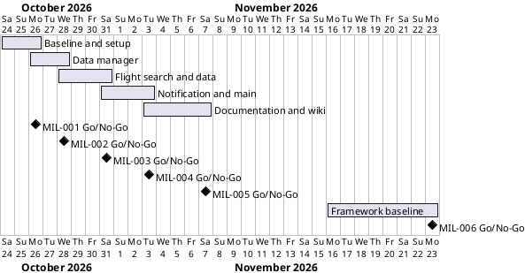

# Project Plan

## Metadata
| Key | Value |
| --- | --- |
| ID | PP-001 |
| CrossReference | [BC-001], [SA-001], [MIL-001], [MIL-002], [MIL-003], [MIL-004], [MIL-005], [MIL-006] |
| Language | en |
| Domain | education |

## Version History
| Date | Status | Author | Reviewer | Change | Commit |
| --- | --- | --- | --- | --- | --- |
| 2026-10-24 | Deprecated | Jens Tirsvad Nielsen | S01 | Initial version | [1c49ffe] |
| 2026-11-16 | Accepted | Jens Tirsvad Nielsen | AI as stand-in for S01 | Added the baseline gateway (MIL-006) with its schedule row, scope coverage, dependency, risk and Gantt entries; linked the milestones of the git host; added the sources of the planning assumptions, the rule for a No-Go and Open Issues; set the domain to education; reviewed against QC-PP-001 for the first time, in autonomous mode, not independent | pending |

---

## Purpose

This plan schedules the five phases that deliver the Day 39 flight-deal finder (see [BC-001]) in a two-week window, and a sixth gateway, the framework baseline ([MIL-006]), that follows them. One branch and one pull request per milestone keep track of the steps.

## Planning Assumptions

- Week 1 starts 2026-10-24; the first five gateways end by 2026-11-07 (source: the decision of S01 at the start of the project; the Target Date of each of MIL-001 to MIL-005 names the two-week window).
- Each phase ends in a pull request that closes its issues; the Product Owner is S01 ([SA-001]) (source: [BC-001], Constraints, one branch and pull request per step).
- Autonomous mode: the AI creates, reviews as stand-in for S01, commits and merges after the user accepts this plan (source: [SA-001], Sign-Off).
- Tests never use the real `.env`, the network or the WhatsApp session (source: [BC-001], Out of Scope and Success Criteria).
- The baseline gateway ([MIL-006]) starts 2026-11-16 and ends 2026-11-23, one week (source: [BC-001], Constraints). It brings the finished project to the baseline of the framework, a decision of S01; the first five gateways keep their dates, so the end date of the plan moves from 2026-11-07 to 2026-11-23 because of it.

## Gateway Schedule

| Gateway | Document | Window | Decision date | Owner | Stories | Main deliverable | Milestone |
| --- | --- | --- | --- | --- | --- | --- | --- |
| Baseline and setup | [MIL-001] | 2026-10-24 to 2026-10-26 | 2026-10-26 | S01 | none | Project skeleton, CI, repository metadata | [Milestone 237] |
| Data manager | [MIL-002] | 2026-10-26 to 2026-10-28 | 2026-10-28 | S01 | none | Sheety read and update | [Milestone 238] |
| Flight search and data | [MIL-003] | 2026-10-28 to 2026-10-31 | 2026-10-31 | S01 | none | Search, parsing, cheapest flight | [Milestone 239] |
| Notification and main | [MIL-004] | 2026-10-31 to 2026-11-03 | 2026-11-03 | S01 | none | WhatsApp message and main program | [Milestone 240] |
| Documentation and wiki | [MIL-005] | 2026-11-03 to 2026-11-07 | 2026-11-07 | S01 | none | README, wiki en/da/ms, screenshots | [Milestone 241] |
| Framework baseline | [MIL-006] | 2026-11-16 to 2026-11-23 | 2026-11-23 | S01 | none | The adopted framework release, the wiki sidebar in the framework's shape, the README, licence and project URL metadata, the traceability matrix and review records | [MIL-006 milestone] |



## Scope Coverage

| Business Case scope item | Gateway |
| --- | --- |
| Project setup, pyproject, constants, .gitignore, Doxyfile, venv | [MIL-001] |
| CI workflows, repository description and topics | [MIL-001] |
| DataManager and request caching | [MIL-002] |
| FlightSearch, FlightData, find_cheapest_flight | [MIL-003] |
| NotificationManager (WhatsApp) and main.py | [MIL-004] |
| README, wiki in en/da/ms, screenshots | [MIL-005] |
| The baseline: framework release, wiki sidebar, README, licence and project URL metadata, traceability matrix, review records | [MIL-006] |

## Dependencies

```
MIL-001 → MIL-002 → MIL-003 → MIL-004 → MIL-005 → MIL-006
```

A No-Go on a phase moves every later date and the end date of the plan by the rework time; S01 decides the new dates. A No-Go on [MIL-006] leaves the program and the earlier gateways as they are.

## Plan Risks

| Risk | Impact | Mitigation |
| --- | --- | --- |
| CI workflows need changes or a runner the host lacks | MIL-001 slips | Install only fitting workflows; stop and report after three failed fixes |
| Screenshots cannot be captured without real data | MIL-005 slips | Use mock data and a test run only |
| The SerpAPI key is missing from the local `.env` | MIL-003 uses only the mock provider | Provider is a setting; mock keys exist locally |
| A continuous integration (CI) check fails on the pull request of [MIL-006] | The merge is delayed past 2026-11-23 | The failure is fixed on the same branch and the checks run again; after three failed rounds on one cause the work stops and S01 decides (trace: success criterion 7 of [BC-001]) |

## Open Issues

- The WhatsApp module is assumed to be `pywhatkit` ([BC-001] Assumptions); the user can correct it before acceptance.
- No SerpAPI key is in the local `.env` yet; the mock flight service is the default until it is added.
- The Gateway Schedule links the milestones of the git host; the Milestone column was empty until the baseline.
- The plan was accepted without a QC checklist until [MIL-006]; since then it is reviewed against `QC-PP-001` (RC-009).
- The commit "Use git-workflows and the scoped workflows" moved the workflow callers to the shared repository `TirSystem/git-workflows`; the earlier documents (for example the deliverable of [MIL-001]) still name it `TirSystem/github-action`, as it was named when they were accepted.
- Domain: since [MIL-006] the plan, the Business Case and the baseline milestone have the domain `education`. The other documents (Stakeholder Analysis, milestones MIL-001 to MIL-005 and the review records RC-001 to RC-007) keep the domain `it` they were accepted with; they are not changed by the baseline, and a change of their domain would need a new review of each.

---

[BC-001]: ./business-case.md
[SA-001]: ./stakeholder-analysis.md
[MIL-001]: ./milestones/mil-001-baseline-and-setup.md
[MIL-002]: ./milestones/mil-002-data-manager.md
[MIL-003]: ./milestones/mil-003-flight-search-and-data.md
[MIL-004]: ./milestones/mil-004-notification-and-main.md
[MIL-005]: ./milestones/mil-005-documentation-and-wiki.md
[1c49ffe]: https://git.tirsystem.com/Tirsvad-Udemy-100-days-of-code/039-personal-flight-club/commit/1c49ffebbd94841e90fa1ff84ba0e6bf39ea3625
[Milestone 237]: https://git.tirsystem.com/Tirsvad-Udemy-100-days-of-code/039-personal-flight-club/milestone/237
[Milestone 238]: https://git.tirsystem.com/Tirsvad-Udemy-100-days-of-code/039-personal-flight-club/milestone/238
[Milestone 239]: https://git.tirsystem.com/Tirsvad-Udemy-100-days-of-code/039-personal-flight-club/milestone/239
[Milestone 240]: https://git.tirsystem.com/Tirsvad-Udemy-100-days-of-code/039-personal-flight-club/milestone/240
[Milestone 241]: https://git.tirsystem.com/Tirsvad-Udemy-100-days-of-code/039-personal-flight-club/milestone/241
[MIL-006]: ./milestones/mil-006-framework-baseline.md
[MIL-006 milestone]: https://git.tirsystem.com/Tirsvad-Udemy-100-days-of-code/039-personal-flight-club/milestone/554
